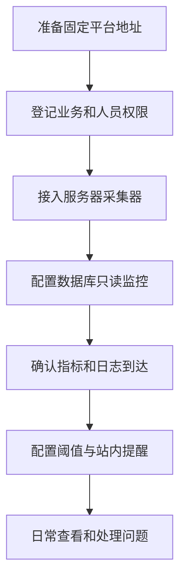
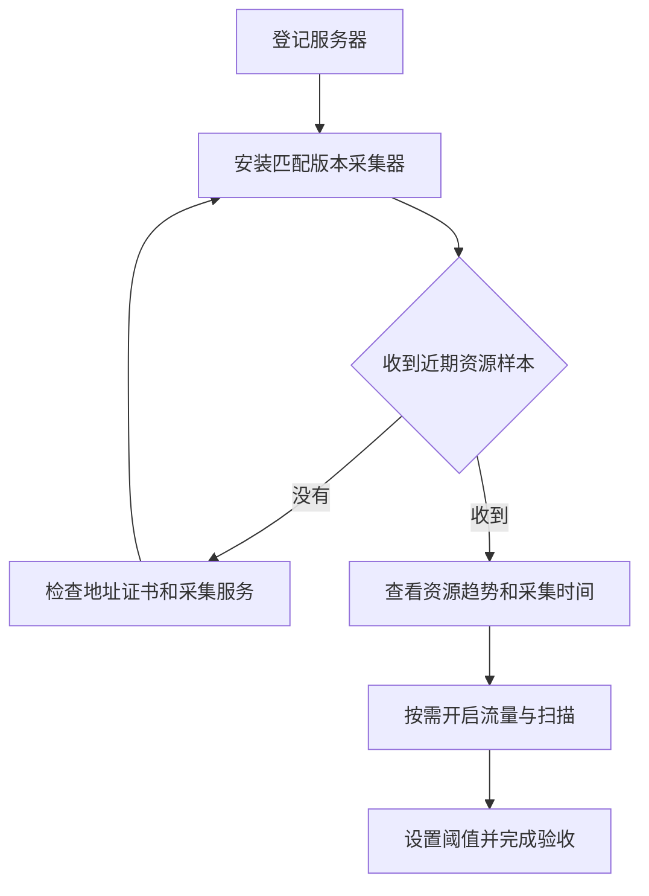
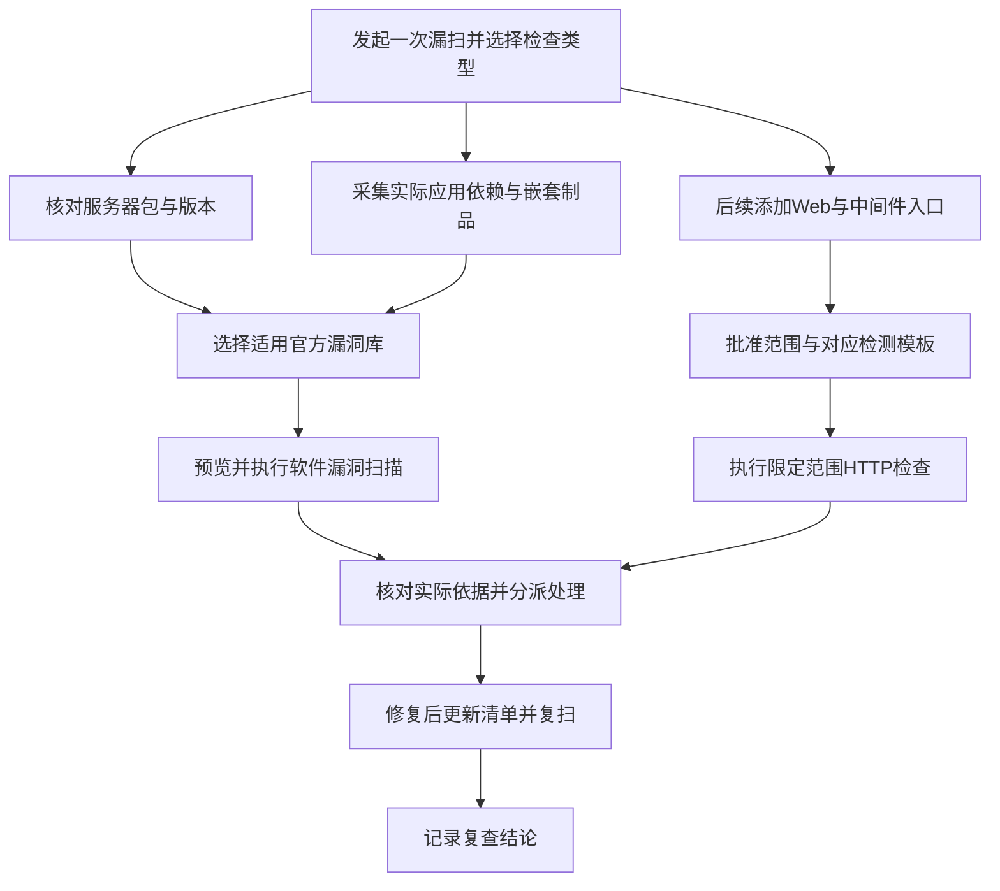
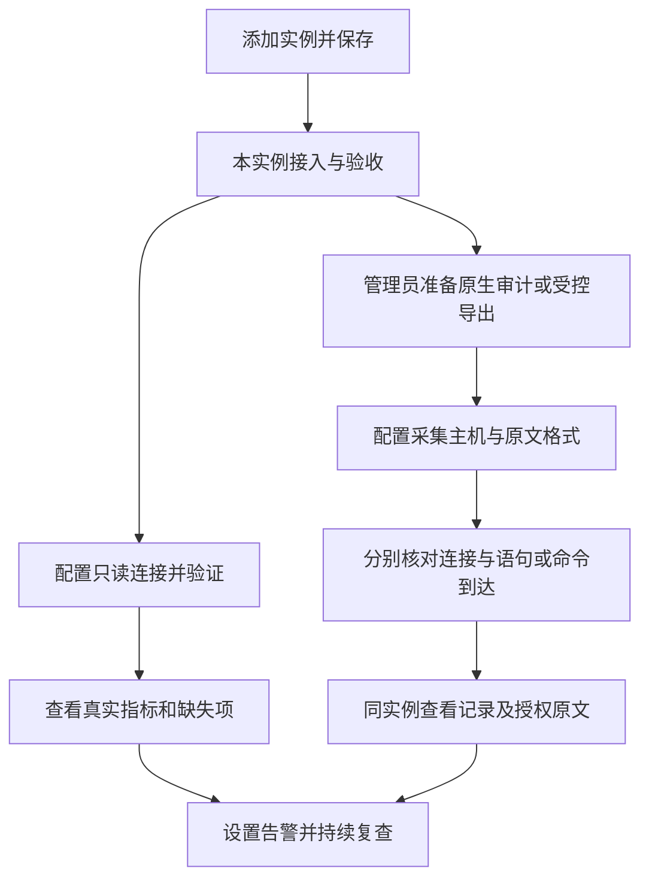
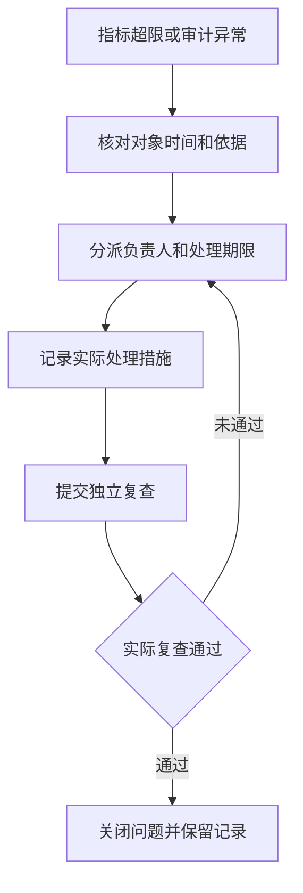
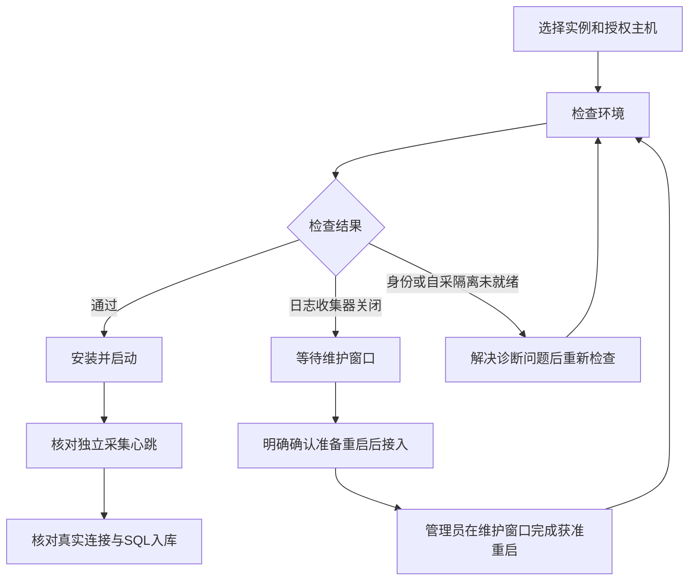
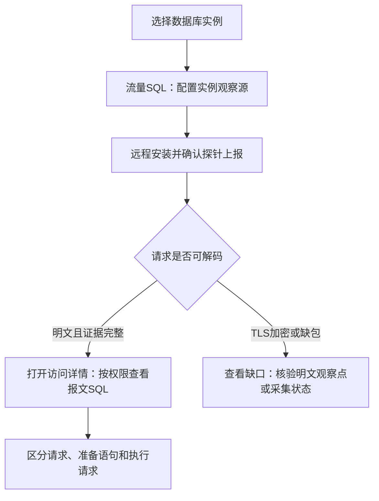

# Self Guard 使用指南

平台本期用于资产接入、主机流量观测、漏洞检测和数据访问审计。先查看采集状态，再核对实际记录与证据；无记录、未采集和已验证正常是不同状态。

## 开始使用

第一次使用按三个步骤进行：先在“资产”登记主机及所属业务，再安装Agent并确认上报，最后按需开启流量、协议或数据访问采集。登记资产不代表已启用监控，Agent在线也不代表协议或正文采集完整。

日常从“概览”的待确认问题开始，点击问题查看涉及对象和判断依据，再按需展开技术字段或请求响应。概览的三项问题指标只统计待确认（OPEN）状态；新增“采集与检查覆盖”独立展示主机上报、持续监控、旁路引擎、访问来源、原生审计、扫描运行及未完成处理情况，计数均受当前权限限制。近期上报不代表采集完整；已确认但未完成处理的记录仍可在对应列表切换状态查看。没有待确认记录不代表已经完成安全检查。

### 交付前准备

交付方先将平台部署在长期运行的服务器上，提供目标主机可访问的固定HTTPS地址、可信证书及可安装的采集版本；本地演示地址只用于开发验收。管理员创建业务分组和人员账号，分别授权主机、数据库实例及证据范围，确认备份、保留策略和磁盘预算。用户不需要把密码发到聊天或备注中，连接凭据仅在受控配置表单中保存。

第一次接入建议选择一台Linux服务器和一个PostgreSQL实例。先接入并验收，再扩展到其他主机；其他操作系统和数据库引擎以页面明确支持的范围为准。

### 接入与查看主机

“资产 → 业务分组”用于登记和查看资产所属业务，点击页面右上角“新建业务分组”独立创建。新增和编辑表单从右侧打开，关闭后保留原列表筛选。新建空分组也会显示；点击分组可查看对应主机。资产新增、编辑时可选择所属业务，有完整管理权限的账号可在表单内创建分组；清空并保存表示取消该资产的业务归属。

在“资产 → 主机资产”添加主机，通过“资产接入”安装基础 Agent。自动发现只为内网IPv4及IPv6 ULA对端生成候选，公网访问不生成待认领资产，已有公网主机和认领历史保留。已发现的内网主机在“待认领资产”核对后认领，本机地址、通配监听地址和已有主机不重复认领。

进入“网络安全 → 流量分析 → 连接记录”，先选择主机，再看持续连接与流量；服务和监听端口位于“服务与端口”标签。端口的软件名称优先依据可读取进程关联，单凭端口只显示“常见用途（未确认）”；旧 Agent 或权限不足时保持未识别。“连接与流量记录”每条汇总一个时段的通信方向数、报文数、合计字节和平均速率；相反方向分别计数，不是单次请求，也不能据此统计独立用户或准确会话数。连续摘要与临时抓包分别显示，临时捕获的结束时间不代表连续监测停止。监测设置与临时抓包位于选定主机右上角“采集配置”中，资产列表“更多”仍保留原入口；常规查看不要求先配置 SSH。

“目标或来源端口”的下拉项是常用快捷选项，也可直接输入任意1–65535端口并按回车添加；多个端口支持逗号、中文逗号或空格分隔，例如8080、9000和18080。当前持续监控和临时抓包均要求1–16个具体端口，不支持端口范围或全部端口。来源端口或目标端口任一命中即采集：配置8080时，发往8080的请求和来自8080的返回流量均在范围内。

服务器接入按以下步骤操作：

1. 在“资产 → 主机资产”登记名称、地址、业务和负责人。
2. 从资产接入创建安装授权，资源监控选择0.4.21及以上、匹配系统/架构的已发布版本；在目标主机执行页面生成的安装命令。请安装在Linux宿主机上；容器内的采集会明确标为部分视图，不能当作整台服务器的资源监控。先确认基础Agent近期上报，再确认资源指标到达。只登记主机不会启动监控。
3. 打开该主机的“资源监控”，查看CPU、内存、负载、文件系统容量和inode、运行时间及网络计数；首次CPU/速率计算需要前后两个样本，页面显示待计算而不是零。
4. 进入“网络安全 → 流量分析”，选择同一主机，按需启用持续连接采集、查看服务与端口；协议记录需要独立来源，不能由资源曲线代替。
5. 配置资源阈值及持续样本数。连续超限才生成风险；恢复后的资源值与历史风险分开查看，问题关闭仍需复查。

资源趋势保留24小时。当前文件系统容量覆盖本地磁盘；NFS、CIFS及FUSE等远程或用户态挂载保留明确缺口，避免失联挂载阻塞采集。文件系统使用率按已用与普通用户可用空间计算，避免将保留块当作业务可用空间；inode不足也会单独告警。网络指标汇总非回环接口计数，虚拟网卡和桥接可能重复计数，不能据此统计独立请求数或业务吞吐。旧Agent没有资源字段时会提示更新；采集失败、部分数据和过期分别显示，不会画成零使用率。

主机摘要不等于接口正文。需要查看路径、请求与返回内容时进入数据访问审计，并核对该主机是否存在已授权、正常运行的探针。

### 漏洞检查与结果核对

打开“网络安全 → 漏洞管理 → 开始与准备”，从“发起一次漏扫”开始：

1. 选择“主机软件”或“Web 与服务”。前者核对已上报的软件版本，后者向批准入口发送检查请求；两者的覆盖不同。
2. 查看准备提示。缺软件适用库、主机、有效期内的软件清单、网络目标或已批准规则时，按旁边的入口完成准备，再返回本页。清单缺失或过期时先恢复上报，点击“刷新检测准备情况”；恢复上报不代表需要重启数据库，也不会自动升级采集器。
3. 点击“选择目标并继续”，选择此次主机和适用情报来源，或选择已批准的服务入口。Web默认采用当前全部协议兼容的已批准规则。
4. 点击“预览目标范围”或“预览网络范围”，核对可检查对象、跳过原因、路径和请求额度，再点击“保存并开始扫描”。首次操作默认手动执行，不会安排周期任务；高级设置可按需展开。
5. 页面直接打开本次运行，排队和运行期间自动刷新进度。打开目标查看逐项依据；从“查看风险与处置”进入问题核查、分派与修复复扫。

如果提示计划已保存但未确认扫描启动，留在当前计划核对运行记录，再按“立即检查”重试，无需重新创建计划。计划保存与执行是两个独立操作；只有明确点击“保存并开始扫描”才会连续完成两步。原计划管理页的“保存计划”仍只保存。

“检查结果”展示漏洞与配置风险，详情提供受影响资产、版本条件和检测依据。“漏洞数据源”及“来源与更新”可在扫描工作区直接进入；检测规则、基线、适用范围和样本验证在“扫描配置”中。

扫描结果不代表漏洞已被利用，也不提供实时攻击阻断。检查失败、清单过期、条件不足应作为覆盖缺口核对，不能解释为安全。变更由现有运维流程完成，再复扫确认。

### CVE与在野漏洞如何管理

统一入口为“网络安全 → 漏洞管理”，旧扫描入口仍可访问。默认“开始与准备”提供直接发起入口；原使用与覆盖说明保留在“操作说明与覆盖边界”，来源状态、主机准备情况和CVE查询位于下方。清单准备状态只表示已采到软件及版本，不代表已扫描或所有CVE都有规则。

| 标签 | 用途 | 首次使用应完成 |
| --- | --- | --- |
| 开始与准备 | 发起一次漏扫，查看真实准备情况和CVE查询 | 选择检查类型，处理缺失项后直接进入目标选择与预览；没有历史计划不妨碍首次发起 |
| 情报来源 | 独立管理组件适用库、NVD和CISA KEV | 选择实际系统/SP/架构或软件生态，确认同步成功及范围；NVD年度库只覆盖配置的年份 |
| 软件漏洞扫描 | 管理明确目标的软件版本检查计划 | 首次检查推荐从“发起一次漏扫”进入；原管理页仍可仅保存计划，再明确点击立即检查 |
| 目标与模板 | 管理授权入口、模板和执行身份 | 先登记入口；管理员维护检测规则库及规则批准，日常按目标发起通用扫描 |
| 主动验证 | 对已授权入口运行适配的只读检查 | 预览主机、端口、路径及模板组合，选择运行时间与额度，再发起检查 |

### 服务器组件、应用与Web分别怎么扫

| 检测线路 | 实际读取或请求什么 | 必须准备 |
| --- | --- | --- |
| 服务器组件 | Agent采集的发行版、架构、软件包完整版本和源包身份 | 对应Ubuntu、Debian、Alpine或麒麟SP/架构的适用库；不能跨发行版套用 |
| 应用与中间件依赖 | 实际node_modules、Python已安装包、Java JAR/WAR及嵌套Maven坐标、Go二进制构建信息 | 官方npm/Maven/PyPI/Go依据，以及明确授权的应用目录或制品路径 |
| Web与中间件入口 | 已批准主机/端口/路径上的明确HTTP响应条件 | 具体模板的校验/批准、目标范围批准、计划预览和明确执行 |

Nginx、Docker、Node.js、Spring Boot只是软件示例，操作统一围绕实际组件、网络目标和通用规则，不需要单独的品牌流程。组件适用库用于版本判断；网络规则用于实际响应或连接条件判断，两者的依据和覆盖不能互相替代。

在采集配置里添加实际应用输入。Java嵌套依赖采集请选择Agent0.4.23或更新支持版本，填写已授权目录内的JAR/WAR；采集器不运行制品、不解压落盘，保留内层坐标路径和摘要。四层嵌套、100个内层归档、10,000项累计条目、单内层16MiB/累计256MiB解码及32MiB坐标/目录元数据预算之外明确显示不完整。ZIP64、分卷、无坐标/混淆或被修改的制品需另行补充可信依据；不能只凭文件名或锁文件当成实际安装版本。

管理员在“目标与模板 → 检测规则库”同步官方 Nuclei 模板目录，核对来源版本、快照摘要、许可、目录总量、结构兼容和不支持条目。同步只更新目录，不自动批准规则、修改旧计划或扫描目标。若官方最新版本查询受限，平台会明确提示并继续使用已完整校验的既有目录；以页面显示版本为准，不表示已经更新至最新版本。按CVE、规则编号和分类检索，点击“编译并批准全部兼容规则”，平台先核对完整目录和固定版本，再按执行数量分批编译与批准；进度和跳过项会明确展示，失败即停止剩余批次。需要小范围维护时仍可勾选规则单独批准。结构兼容与编译通过不等于实际命中，也不是正反样本测试；本地自研模板仍需正反样本校验和管理员批准。

首次准备：在“授权网络目标”登记并批准明确主机、协议、端口及允许/排除路径。日常从“发起一次漏扫”选择“Web 与服务”，选择目标并保留默认“通用扫描 · 当前全部已批准规则”；预览准确规则集与目标组合，再明确点击“保存并开始扫描”，直接查看本次运行与逐项结果。可选自定义规则范围，每个计划最多5000条，超过上限需显式分批。预览固定规则版本，规则库更新不会扩大已有计划；规则或目标授权撤销会阻止执行。

当前原生执行配置只支持独立、无状态的单次GET/HEAD响应判断。平台受控请求后交由固定版本引擎离线匹配，仍受批准地址、路径、排除项、授权和额度限制。多请求依赖、原始报文、脚本/代码、浏览器、外部回连及其他未适配语义列为不支持，不丢弃条件后强行执行。带RCE、DoS、暴力破解、上传或写文件等高影响标签的规则，以及主动注入路径，不属于默认受控配置。TCP/TLS沿用明确批准的兼容检查。目录已收录、结构兼容、原生编译通过和真实检测结果分别查看，不能把目录总量或隔离样例当成全部CVE检测覆盖。

暂时没有Web目标也可先准备官方库、采集版本和模板，后续登记域名或IP/端口及允许/排除路径，再预览和执行。平台不因添加漏洞库、安装模板或打开本页自动扫描任意站点。当前未授权的业务入口不会被测试。

CVE查询输入完整编号，显示当前配置来源的直接关联、上游引用、适用记录以及过期/撤回状态。CISA KEV只补充“已知在野利用”的优先级信息，不能单独确认目标存在漏洞；未关联到KEV也不表示没有利用风险。NVD的产品描述或评分不能独立确认软件版本受影响。只有适用系统和软件版本依据匹配后，才能产生有依据的软件风险；对应主动规则才能进一步检查服务行为，不承诺覆盖全部CVE。

主机软件检查使用Agent实际采集清单，锁文件或SBOM单独提供的版本仍需核对实际部署。旧清单先恢复采集，来源不适用先补对应组件库；不要用其他发行版的软件公告代替当前系统。情报同步、查询编号、导入规则和保存计划是不同操作；它们不会自动执行业务扫描。未成功同步的来源和未批准的模板必须先处理。

在“软件漏洞扫描”或“主动验证”的运行记录中打开实际目标和逐项依据。版本命中、主动条件命中、未命中、跳过和无法判断分别核查；从“查看检查结果与处置”进入问题详情，登记负责人、期限与实际处理措施。修复后在原计划再次执行，比较新的时间、清单和来源；保存复扫依据后登记人工复查，不自动以一次未命中关闭问题。

受限账号只能查看授权主机的准备情况，当前全局情报与扫描配置需完整数据范围。无证据权限无法读取漏洞依据；管理员配置执行授权不代替实际目标范围检查。当前没有计划或主动模板时，页面如实显示零与下一步，不能写成交付了全部CVE扫描。

### 入侵检测（Suricata）

在“网络安全 → 流量分析 → 协议记录”查看连接及HTTP、DNS、TLS等上下文；规则命中统一在“网络安全 → 安全告警”查看。点击协议页右上角“采集配置”维护Suricata来源与健康。来源绑定已接入Agent的采集主机，先登记EVE日志及规则来源，再启用并签发独立采集配置。表单从右侧打开；签发会轮换该来源凭据，编辑后需更新采集器配置。创建来源不自动安装引擎或开始抓包。

Suricata负责独立旁路检测，轻量采集器只读EVE日志，主Agent不提权。规则告警进入“网络安全 → 安全告警”；HTTP、DNS、TLS、连接流、协议异常和引擎统计保留为核查上下文。点击事件可按同一来源、Flow ID和时间范围查询关联记录；Flow ID不是跨引擎重启的全局会话标识。离线回放会单独标记，不能作为当前攻击或引擎在线的证明。

先核对采集器最近上报，再看引擎stats、丢包、规则加载失败和实际规则文件指纹。登记版本、文件校验通过不代表运行引擎已加载。缺少stats时保持待确认，没有事件不能认定没有攻击。只索引受约束元数据，不上传原始报文、认证头或查询串；请求与响应正文仍在已授权的数据访问审计中查看。

事件索引最长七天且每来源最多50000条，较早记录会按容量滚动清理；幂等确认与事件身份保留八天，并各有100000条预算，达到上限会背压并保留采集器待确认批次。生产容量须按实际EVE速率评估。规则由部署侧按周期使用官方suricata-update检查，先验证候选再加载；平台不自动修改业务代理、上线规则或启用阻断。

### 数据实例、分类与访问

在“资产 → 数据实例”登记数据库或缓存，关联授权采集主机。先核对实例身份、组件版本与审计来源；同一主机可以关联多个独立实例。

数据库需要分别接入“运行监控”和“原生日志审计”。运行监控关注可用性、连接、事务、等待和容量；审计关注谁在何时访问以及日志记录的操作，两者独立验收。

1. 在“资产 → 数据实例”添加类型、版本、稳定标识、负责人和实际入口，关联已授权主机。保存后直接进入这个实例的“接入与验收”。先阅读本引擎能力说明。
2. 点击“配置运行连接”，在“运行连接与指标”配置登记入口、独立只读监控账号、目标数据库或服务名和可信CA。点击“保存并验证连接”。保存成功不代表连接成功；验证失败会保留配置和失败原因，修正后再次检查。密码加密保存且不返回页面，远端连接必须校验证书。
3. 核对实际版本、最近样本与缺失指标。缺字段保持“未提供”，不当作零。按需开启每分钟采集和阈值，等待两个有效样本查看速率，查看24小时趋势。检查失败或样本过期时不能把旧曲线当作当前正常。
4. 要查看访问记录，先由数据库管理员启用所需审计或受控导出。在本实例“编辑实例 → 独立审计采集”选择主机、绝对路径和本引擎日志格式；Agent读取文件，平台不会自动执行这些导出模板或重启数据库。原文格式需Agent0.4.24及以上；旧版Agent在线不能证明新格式已支持。
5. 返回“接入与验收”，分别核对主机上报、连接事件、语句或命令事件、仍在保留期内的原文。点击“查看本实例记录”，在同一个实例内筛选账号、操作、时间和记录类型；原文需要单独点击查看并经过独立授权。

| 引擎 | 运行监控接入前提 | 语句或命令来源与限制 |
| --- | --- | --- |
| PostgreSQL | 14+，独立LOGIN账号、CONNECT及pg_read_all_stats，限制网络、连接数和超时 | 连接日志、pgAudit元数据、执行原文CSV分别选择；现有试点SQL仍等待维护窗口，不重启业务库 |
| MySQL | 5.7/8适配；8.4隔离实测。只读系统统计权限；远端TLS使用证书匹配的DNS名称 | 认证错误仅失败连接；Enterprise Audit需要实际授权插件，显式原文格式读取query；Community不自动具备插件审计 |
| Oracle | 当前Thin采样12.1+，专用V$统计视图权限和准确服务名；Oracle26ai完整TCPS及专用只读账号已隔离验收 | 11g传统、12c+统一审计需管理员导出；SQL_TEXT缺失时没有原文，11g运行监控尚未交付 |
| Redis | 允许必要INFO命令的专用ACL账号；不读取键值，不运行MONITOR | 查看命令而非SQL；SLOWLOG受控转换只覆盖慢命令且可能已被Redis截断，缺少账号和执行结果时保持未知 |
| 达梦DM8 | 远端运行监控未就绪：当前已测驱动不安全校验证书，平台拒绝；受限驱动不随平台分发 | 支持已关闭审计文件的不可变快照转换；显式保留SQL_TEXT，绑定值不导出 |
| 人大金仓 | 已实现产品身份与sys统计视图适配，尚缺真实产品版本介质验收 | 受控导出转换为标准审计JSON；不把普通PostgreSQL验证当作金仓验证 |
| 海量Vastbase | 已实现Vastbase身份与统计视图适配，尚缺真实产品版本介质验收 | 受控导出转换为标准审计JSON；其他海量产品不自动等同Vastbase |

Oracle接入时，数据库管理员在目标PDB创建专用监控账号，将权限限定为`CREATE SESSION`及`SYS.V_$VERSION`、`SYS.V_$SESSION`、`SYS.V_$PARAMETER`、`SYS.V_$SYSSTAT`、`SYS.V_$INSTANCE`的`SELECT`。实例入口填写实际TCPS监听端口和证书匹配的域名，服务名填写目标PDB服务；私有CA填写PEM证书。保存并验证后，核对真实版本与指标，缺失字段仍按缺口处理。已完成的Oracle26ai验收不代替其他版本和目标实例的验证。

运行监控只执行固定聚合统计查询，不查询业务表、SQL正文或命令参数。每个引擎实际字段不同。审计来源的启用、权限与覆盖由数据库管理员核实；“有适配”不等于当前实例已通过。数据库启用原生日志可能有维护窗口，先评估再安排。

“数据安全 → 分类分级”维护目录、类别、敏感等级和判定依据；未分类或部分覆盖会如实显示。分类规则用于解释风险，不能据此声称数据库端已执行脱敏或导出拦截。

“数据安全 → 访问审计”通过“请求与响应”查看旁路访问，通过“数据库审计”查看原生审计记录，通过右上角“采集配置”核对探针覆盖。切换时保留目标页面支持的实例或主机范围。两种来源不会自动拼成同一次访问，最终业务用户没有可信证据时保持未知。

### 核查异常与证据

网络和数据分别在各自的“安全告警”查看异常。详情用于核对来源、实际结果、受影响资产及分类依据；可记录核查备注，在合法状态范围内确认风险、标记误报或重新打开。

准入与行为规则位于数据告警工作区；普通访问不以命中告警为留存前提。默认不读取原始报文，查看和导出正文分别需要授权，并受主机、实例范围限制。点击分段的“查看原文”后，以代码视图显示行号；JSON 自动缩进，HTTP 分开显示头部和正文，二进制显示十六进制偏移及可打印字符。可切换“格式化 / 原文”和自动换行，格式化不修改留存与下载的原始字节。

正文从捕获时间起保留7天，上传重试不续期。超配额、断流、解析不支持和TLS不可见会显示缺口；不能根据连接摘要推断完整请求或响应。其他数据库和TLS组合的支持以实际验收记录为准。

## 当前范围与维护

### 功能范围

本期不提供自研 WAF 实时拦截、审批流转、调查编排、自动修复和独立报告中心。旧链接显示退出说明，历史数据保留；本次界面收敛不删除业务记录，也不修改已有反向代理。

需要导出时，在安全记录列表先筛选范围再导出结果。概览的问题数字仅统计当前授权范围内的待确认状态，点击后保留相同状态筛选；主机、实例与访问总量放在管理范围中，不能用于证明采集完整。

### 设置与权限

右上角“设置”保留用户权限、通知、数据保留、备份、操作审计和平台状态。Agent维护及组件凭据在平台状态工作区；通知投递记录在通知设置工作区。管理员维护操作与日常查看分开，隐藏入口不替代服务端权限检查。

采集异常时先核对基础Agent、独立探针和来源的各自状态。基础Agent在线不代表TLS明文或所有数据库协议已覆盖。不要为获得正文而关闭业务加密。

## 问题处理与复查

从网络或数据安全记录打开详情，先按“核查与后续处理建议”核对对象、时间和实际依据。管理员与分析员可以“由我跟进”或分派负责人，并设置处理期限；清空期限后保存会取消该期限，不会安排自动执行。

有效问题进入处理中，记录实际外部处理措施后选择“处理完成，提交复查”。风险和告警均可进入待验证状态，再由有处置权限的人员完成实际检查并“登记复查结果”：通过后风险关闭、告警已处理；未通过返回处理中。此操作记录人工复查，不会自动执行扫描、修改业务或提供人员职责分离保证。若需要独立扫描证据，请先在原授权范围执行检查，再填写实际结果。

误报应说明依据；风险接受必须设置未来到期时间，到期重新进入待确认。证据不足时继续核查，不能用误报或关闭代替未知结果。处置、负责人和期限变更保留审计记录；陈旧表单被拒绝后，关闭并重新打开详情再提交，避免覆盖其他人员的新结果。

概览显示未完成、未分派、待复查和逾期问题数量，可从“查看处理记录”继续筛选核查。通知与投递仍通过原设置维护；保存处置不会自动启用外部通知或执行阻断。

### 核对数据库连接日志是否真正接入

打开“数据库实例”的实例详情，依次核对日志来源、采集主机近期上报和实际采集入库。已登记实例、已配置来源、收到主机上报分别表示不同进度；只有审计记录到达后，页面才显示“近期收到审计记录”，这仍不代表完整覆盖。

进入“数据库审计”查看连接认证、失败认证及断开连接，按实例、账号、来源和时间筛选。“高级筛选”中的执行结果可选失败。认证通过不保证之后的SQL访问获准或成功；断开事件不推断正常退出。连接日志与请求响应正文分别接入，日志不会自动补出SQL、请求/返回正文或未知TLS状态。未启用前的历史连接无法补录；未知格式、缺失身份或不支持的异常断开应继续检查采集缺口。

SQL执行或命令记录需单独配置本引擎的显式原文来源；PostgreSQL选择 `PostgreSQL SQL执行原文CSV`。接入后，在“数据库审计 → 高级筛选 → 记录类型”选择“SQL执行”，点击记录中的“SQL · 耗时”，再选择“查看SQL原文”。原文加密保留7天，查看需要管理员或独立SQL原文权限，并受实例范围与证据权限约束；到期立即拒读，后台清理到期密文。每次查看留下操作审计，普通列表与告警不展示原文。

SQL按数据库记录的文本保留；预编译语句保留占位符，未采集绑定参数和返回内容。多语句批次耗时属于整批，语句完成不等于事务最终提交。当前宿主机PostgreSQL14只有连接日志接入，SQL来源需在批准的数据库重启窗口切换，不能把隔离验收或实例登记当作业务SQL已采集。

### 独立核查结论与站内提醒

风险和告警详情中的“记录核查结论”支持“重复问题”“证据不足”和“撤销当前结论”。重复问题需选择自己有权查看的同类型原问题，可点击关联标题查看；不能关联自身、重复项或形成循环。证据不足应记录缺少什么依据及后续核查安排。结论保留原处理状态，实际解决仍需按处理与复查流程关闭；撤销结论保留操作审计。遇到记录已变化，请刷新详情后重新判断。

进入“设置 → 通知设置 → 站内提醒”，可订阅普通指派问题和超期提醒；新增两项默认关闭。普通问题只提醒当前负责人；超期提醒按处理期限去重，超过24小时向开启此项且有权限的管理员升级。调整期限会重新计算，已关闭或风险接受期间的问题不生成此类提醒。去重依赖保留的通知记录，清理通知后仍未处理的问题可能再次提醒。这两项仅在站内出现，不会进入外部通知渠道；通知中的“查看问题”打开对应记录，历史通知不代表问题仍处于生成通知时的状态。

当前PostgreSQL SQL原文接入按用户要求保留待启用；本轮后续功能无需重启宿主机数据库。

## 监控验收与排障

### 如何确认监控正常

依次核对“对象登记 → 采集服务 → 最近成功样本 → 实际指标或日志 → 告警与处理”。主机资源超过3分钟没有新样本会标记过期，启用资源告警时生成断流告警；恢复后仍需人工复查。采集延迟超过页面新鲜度窗口、证据权限不足、来源未启用和没有数据是不同情况；不能用主机在线代替数据库正常，也不能因没有告警就判断安全。

| 页面现象 | 用户应检查 | 通过标准 |
| --- | --- | --- |
| 已登记但从未上报 | 平台地址、证书、授权票据及目标采集服务 | 主机出现真实近期上报 |
| 主机在线但没有资源指标 | 采集版本、Linux支持及/proc读取权限 | 资源采集时间持续更新，缺失项有明确原因 |
| 数据库运行检查失败 | 登记入口、账号、TLS证书、网络和统计权限 | 固定只读检查成功并得到真实样本 |
| 只有连接日志 | 实例审计来源和数据库日志开关 | 明确哪些事件已记录，未开启SQL时不承诺正文 |
| 旧曲线仍在但显示过期 | 当前服务、网络及采集错误 | 恢复后出现新的成功样本，旧样本不冒充实时 |
| 超限但未生成风险 | 阈值、持续样本数、时间间隔及采集完整性 | 满足持续条件后生成可追溯风险 |
| 无法查看原文或关联问题 | 实例范围与独立证据权限、保留期限 | 仅授权人员在期限内查看，越权明确拒绝 |

### 交付验收清单

交付人员与实际使用者一起完成：登记一台真实主机并安装采集器；核对资源当前值和趋势；核对持续连接、端口与一次授权扫描；用独立只读账号接入PostgreSQL并验证连接/事务/等待/容量；确认审计来源确实到达；在隔离环境验证阈值、断网、账号错误、证书错误和到期清理；走完负责人、期限、处理、复查和站内提醒。记录版本、对象、时间、结果和剩余限制，不对业务制造高负载或锁等待来验收。

功能交付验收与生产接入验收分开记录。采集程序已构建不代表业务主机已安装，连接配置已保存不代表账号或网络有效，短时隔离通过不替代持续负载和长期保留验收。生产环境需另行确认固定部署地址、已发布版本、最小授权和维护窗口；不会因打开指南或保存监控设置自动重启数据库。

### 通过平台远程管理两类探针

协议 / IDS：进入“网络安全 → 流量分析 → 协议记录 → 采集配置”，选定来源，点击“远程安装 / 管理探针”（健康详情也提供入口）。先在绑定资产保存 SSH 连接，检查环境、读取主机实际网卡，选择获准网卡后安装并启动。保存来源、下载配置、环境检查通过和安装命令完成都不等于引擎健康；继续核对真实心跳、引擎统计与规则加载。未配置并加载已批准的检测规则时，仅提供协议采集，不能视为入侵检测就绪。

数据库 / API：进入“数据安全 → 采集覆盖与探针”，对选定观察源点击“远程安装 / 管理探针”，检查环境后安装并启动。平台沿用该来源已授权的接口、地址、端口或固定进程范围。未启用授权时不能安装，仍可检查或停止；缺失依赖、不支持的系统或进程观察条件以任务诊断为准。无需复制安装脚本；下载配置保留为高级手动接入方式。

任务排队、正在检查 / 安装、命令完成等待心跳与真实采集状态分别显示。没有业务流量时没有新事件是正常情况，不能用空列表判定离线。需要停机时在同一窗口点击“停止服务”；如需撤销采集授权，再在来源操作中停用。再次启动使用“安装并启动”。

持续连接流量独立于上述两类探针：在流量分析选定主机，打开“采集配置”，使用“启用持续监控”或“停止持续监控”。临时抓包结束不会停止持续监控。当前获准范围仅为当前主机 eth0 / 443；不要因安装探针扩大到其他网卡、端口或资产。

### 数据库自动接入

在数据库实例的“接入与验收”点击“自动接入”，或打开同名标签。先选择已授权、SSH 已配置且 Agent 已就绪的主机，选择本实例登记的入口端口并填写数据库名称。运行指标继续使用“配置运行连接与指标”的独立只读连接，不需要重新建立另一套密码配置。

PostgreSQL 可选择宿主机或明确填写 Docker 容器名称；平台不自动扫描其他容器。其他引擎使用“已有日志文件”，选择该引擎已支持的日志格式及授权绝对路径；这不会自动安装厂商审计插件或证明日志已经生成。

检查结果为“等待维护窗口”时，“准备重启后接入”会再次确认，仅持久设置日志收集器，不 reload、不重启数据库，也不立即开启 SQL 记录。管理员完成已批准维护后，点击“重新检查并继续”。更换主机、目标或实例配置后需要重新检查，历史成功不能授权当前安装。系统数据库的独立审计入库隔离未就绪时不可启用，以诊断为准。

任务完成、独立服务心跳和真实语句入库分别显示。安装后点击“刷新接入与数据”或“查看此实例连接与语句”，核对实际数据；无业务查询时可以没有新记录，不自动制造演示查询。SQL 原文仍受独立读取权限及七天期限限制。“停止采集服务”停止独立采集，不代表撤销数据库日志配置或自动重启数据库。

### 从访问流量查看 SQL 请求

PostgreSQL 与 MySQL 实例可打开“流量SQL”，沿用该实例范围查看访问记录；清空筛选不会移除实例。先在“采集覆盖与探针”配置已授权主机、服务地址和端口，确认探针实际接入。没有来源是缺少配置，不代表数据库没有SQL。

打开一条访问详情，按需点击“查看报文SQL”。必须同时具有访问证据和 SQL 原文独立权限；默认隐藏，切换记录、到期或读取失败不会保留此前正文，也不写入浏览器本地存储。正文来自捕获证据，保留七天，可随时隐藏。

“SQL请求”表示观察到发送的语句，“准备语句”不是执行，“执行请求”也不证明执行成功或事务提交。占位符原样保留，不插值绑定参数；缺少同一报文内可信准备上下文时显示缺口，不猜测其他会话中的SQL。

TLS 流量已加密且没有可用明文观察点时，不能从网卡报文恢复SQL。需要按内核、运行库、协议和版本验收已有明文探针；HTTP 明文观察通过不代表数据库 TLS 已验收。不得关闭数据库 TLS，不自动制造查询，也不修改或重启数据库来填充列表。其他协议保留访问记录和缺口说明，不声称已经支持SQL提取。
