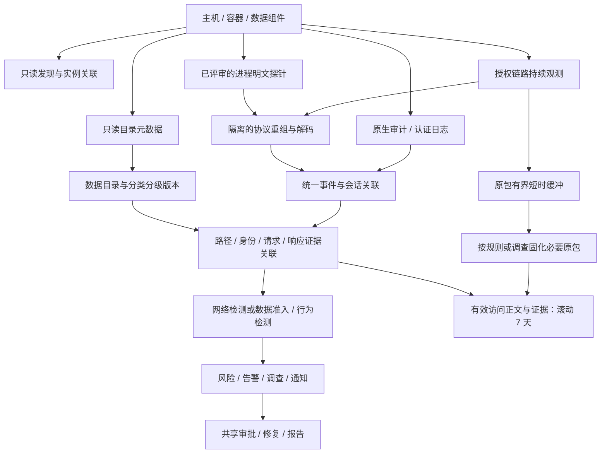

# Self Guard 网络安全与数据安全业务重构规划

**版本：V0.2｜日期：2026-11-04｜状态：方案已确认，待分阶段实施**

本文是独立新增的业务与架构评审稿，基于现有代码和此前验收记录制定。目标是明确两个安全领域的责任，形成从资产发现、持续观测到风险研判和处置的完整流程。本文描述的新增能力均不是当前已上线能力，也不授权立即启用生产正文采集或进程探针。

本版按最新意见修订留存口径：持续观测并保存有效业务访问，按业务日志/会话组织，不要求把网卡全部原包保存 7 天。此前的带宽测算仅作为全量原包场景的参照，不能直接当作本方案所需容量。此前确认的业务返回数据保留要求继续保留；原始抓包如何短时缓冲和按需固化，以下明确列为工程建议。

**评审记录（2026-11-04）：** 用户确认 V0.2 方向。以有效访问记录及对应返回数据留存为实施依据，普通访问与认证/鉴权失败等安全事件均保留，原包采用短时缓冲与必要固化。方案确认不替代指定组件的探针评审、性能验收及生产采集变更流程。阶段执行见[实施总计划与 P0 验证计划](superpowers/plans/2026-11-04-security-domain-observability.md)。

## 1. 已确认的要求与方案选择

| 项目 | 已确认要求 |
| --- | --- |
| 业务分域 | 网络安全和数据安全严格划分；资产、策略、修复、报告保留共享中心定位。WAF 属于网络安全。 |
| 接入方式 | 保持旁路，不接管业务转发；允许按变更流程开启原生审计、接入只读元数据。 |
| 采集深度 | 持续观测监测范围内的有效访问及对应业务返回数据；按访问事件/会话保留，不要求长期保存全部网络原包。普通访问不以触发告警为留存前提。 |
| 保留时间 | 有效访问的业务正文、返回数据及已固化的报文证据先按滚动 7 天设计；短时处理缓冲另设有界策略。 |
| 加密可见性 | 允许对指定组件进行评审、测试和性能验收后，部署只读进程观测探针；不意味着所有进程均可安装。 |
| 资产身份 | 主机资产以单个规范化 IPv4 或 IPv6 地址为认领单位；本机地址、监听通配地址及已有资产不反复生成主机认领。数据实例仍独立管理。 |
| 兼容环境 | 银河麒麟高级服务器 V10 为重点，兼顾已有 CentOS Agent；不得以升级内核、关闭 TLS 或更换业务连接方式作为默认前提。 |

**建议采用混合采集、按访问事件留存的架构。** 单靠网络旁路无法普遍还原 TLS 明文；单靠原生审计通常也拿不到完整结果集。组合使用旁路报文、原生审计、只读元数据，以及经过验证的进程探针，并通过统一会话、对象和证据关系汇合。长期保存去除传输重复后的业务请求/响应及访问记录；原包用于短时处理和必要取证，不与全部返回正文默认双份长期存储。以上采集组合是本稿的工程建议；具体探针技术、存储产品和首批实测版本由阶段 P0 的证据决定。

| 路径 | 能解决什么 | 限制与结论 |
| --- | --- | --- |
| 仅旁路抓包 | 原始网络证据、可解析明文协议的请求与响应 | TLS、进程身份、本地非网络通道及连接池归因有缺口，不满足完整目标。 |
| 仅原生审计与元数据 | 账号、认证鉴权、操作与对象目录 | 返回业务值通常缺失，插件授权及审计覆盖存在差异，不满足完整目标。 |
| 混合采集，逐组件验收 | 组合覆盖网络、身份、对象、请求、响应和路径 | 需要独立证据存储、版本适配及持续覆盖监测；推荐采用。 |

本轮不将数据安全改造成代理网关，不因“准入安全”命名就宣称已能拦截数据库连接；不把未观测到解释为未发生。全文中标为“建议”的默认项供本次评审，不视为用户已批准的配置。

## 2. 当前能力与新增缺口

以下为代码静态核对及现有验收记录所能确认的范围，不代替当前生产健康检查。

| 领域 | 当前基础 | 本次需要补齐 |
| --- | --- | --- |
| 主机与实例资产 | 地址去重认领、独立数据库实例、业务与主机关联 | 本机中间件自动发现、实例匹配、容器与集群关系、覆盖状态。 |
| 主机流量 | Agent 0.4.18 持续摘要监测；60 秒汇总，128 字节截取、窗口预算，不保存正文 | 持续观测、会话重组、有效请求响应提取与证据保留，以及流量检测到告警通知的闭环。 |
| 分类分级 | 分类层级、等级、版本、风险下限；审计观察对象与人工目录 | 只读元数据目录、Redis 对象模型、请求和返回字段映射、覆盖质量。 |
| 准入与行为 | 六类关系型数据库标准事件、27 个规则模板；普通审计独立于告警 | 丰富身份、会话、实际结果、SQL/命令语义、返回内容及跨路径关联。 |
| 原生适配 | 部分数据库已有实库元数据审计验证 | “支持标准 JSON”不等于已完成该引擎原生审计，更不等于支持协议和完整响应。逐项验收见第 7 节。 |
| 数据量 | 现有普通审计有 100000 条保护上限 | 持续全量审计的容量、分区/归档、查询、背压和保留机制。不能只调大常量。 |
| WAF | 站点、策略、事件、访问日志和规则来源基础已存在 | 归入网络安全；接入覆盖、规则发布与运行状态一致展示。整套 CRS 正式运行仍受原验收门槛约束。 |

当前数据库事件契约严格限制为六类关系型数据库，且不含 SQL 正文、参数及返回数据。部分 Agent 辅助代码出现 Redis 名称，不代表平台、契约、规则、目录和界面已支持 Redis 闭环。新方案要显式扩展，不复用旧字段偷偷传正文。

## 3. 网络安全与数据安全的责任边界

| 业务问题 | 主归属 | 另一领域如何参与 |
| --- | --- | --- |
| 主机漏洞、组件 CVE、主机入侵、异常进程、网络暴露 | 网络安全 | 数据实例作为受影响对象关联，数据安全不再生成同一漏洞的重复发现。 |
| 扫描、异常连接、可疑外联、流量突增、网络横向活动 | 网络安全 | 若观察到具体数据读取，再关联独立的数据行为事件。 |
| WAF、Web 攻击、站点接入、防护节点、证书 | 网络安全 | WAF 命中 SQL 注入不证明数据库已执行或发生泄露。 |
| 数据库/Redis 的身份认证、权限检查、访问来源、连接加密策略 | 数据安全—准入 | 网络可达性、端口暴露是网络安全上下文。 |
| 查询、读写、DDL、授权变更、危险命令、返回敏感内容 | 数据安全—行为 | 可结合网络外联证据判断可能的泄露路径。 |
| 对象目录、分类分级、敏感返回字段、数据访问路径 | 数据安全 | 共享资产与证据设施，但由数据安全解释业务含义。 |
| 平台自身用户登录、权限与管理操作审计 | 系统管理 | 不混入“数据服务准入”记录。 |

示例：6379 对公网开放是网络暴露；Redis 未认证执行命令是数据准入问题；随后批量读取敏感键是数据行为问题。它们可以进入同一调查，但仍是具有独立证据和计数口径的事实。

每条规则、审计事件、风险和告警有一个明确的主安全领域。跨域调查可关联多个领域的事件；一个修复任务或报告可覆盖多个领域，通过所包含对象列出领域集合。检测事实去重不消除具有不同原因的独立风险；报告分别给出去重调查数和分域发现数，不能直接相加冒充独立事件数。

旧数据按明确规则来源和对象类型映射；无法确定的保留“待分域”，进入共享工作台复核。禁止把全部旧日志或未知记录默认划到网络安全。分域过滤、聚合、导出和钻取均在服务端执行权限校验，不能仅在菜单隐藏数据。

## 4. 导航与共享中心

沿用刚完成的顶部导航和页面详情工作区，建议一级为：**工作台、资产中心、网络安全、数据安全、策略中心、修复中心、报告中心、系统管理**。将原“安全中心”的业务视图按领域拆分，原“Web 防护”进入网络安全；不再保留两个含义重叠的一级入口。

| 中心 | 建议二级分组 | 主要内容 |
| --- | --- | --- |
| 资产中心 | 资产清单、发现认领、业务关系、采集接入 | 主机、逻辑数据实例和 Web 站点统一入口；显示两领域覆盖状态。 |
| 网络安全 | 概览与风险、主机安全、流量分析、Web 防护、调查告警 | 漏洞/暴露/入侵，连接与流量路径，WAF 站点/规则/访问/攻击/节点。 |
| 数据安全 | 概览与风险、组件覆盖、目录与分类、准入审计、行为审计、路径与会话、调查告警 | 关系型数据库与 Redis；正文证据从对应会话钻取。 |
| 策略中心 | 规则与基线、检测与扫描、来源与更新、验证与发布 | 规则统一维护，明确网络/数据标签和适用组件；不再放数据库审计等业务查询页面。 |
| 修复中心 | 任务、审批、模板、批次 | 统一流程；领域、对象和执行能力决定可执行动作。 |
| 报告中心 | 综合报告、分域报告、趋势、导出 | 共享生成机制，支持领域和业务范围过滤。 |
| 系统管理 | 用户、凭据、Agent、存储保留、通知、平台运维 | 证据授权、探针变更、容量与采集健康。 |

分类分级和审计查询移至数据安全；准入/行为规则由数据安全提供预设领域的编辑入口，仍使用策略中心同一实现。漏洞数据源、WAF 规则库必须保留可见入口：前者可从主机安全和策略来源进入，后者可从 Web 防护和策略来源进入，底层是同一份记录。

遵循“中心 → 分组 → 模块 → 对象详情 → 会话/证据”的层级，不把所有模块平铺成一排菜单。沿用现有筛选组件、间距与窄屏行为。保持原 hash 链接和已有书签可达，重定向只改变所属中心，不丢失筛选、权限和返回上下文。

## 5. 资产发现、认领与采集授权

**发现线索 → 匹配已有资产/实例 → 人工认领或关联 → 确认采集范围 → 变更审批与能力检测 → 试运行 → 持续观测。**

1. Agent 读取已授权的进程、服务、软件包、监听连接、容器命名空间及允许读取的非敏感配置字段，给出组件类型、版本证据、端点和可信度。不扫描任意环境变量或命令行密码，不尝试撞库。
2. 本机数据库或 Redis 监听产生“服务/中间件线索”，关联现有主机；不再将本机 IP 或每个端口变成一个待认领主机。远端主机候选继续按现有地址归一化、排除和去重规则处理。
3. 数据实例使用独立稳定身份，可关联多个节点和入口；同一 IP 多个实例允许并存，集群、代理、读写副本及地址复用不能只靠端口去重。证据不足时让用户关联已有实例。
4. 数据对象属于实例内部目录，不作为一台主机反复认领；Redis 键同样不按主机资产计数。
5. 认领不等于同意保存正文，也不等于同意安装探针。采集配置独立记录实例、链路/接口/命名空间、双向范围、数据类型、7 天保留、权限、预算、负责人和批准版本。
6. 自动化可完成发现、能力检查、生成接入建议、已批准采集配置的下发、重启恢复和健康告警。开启原生审计、创建只读账户、附加进程探针及扩展范围通过变更流程执行；不能在升级 Agent 时默认全部开启。

覆盖页面分别展示“发现状态、认领状态、采集授权、报文观测/缓冲与固化策略、原生审计、明文请求、明文返回、对象分类、身份归因、最近成功时间与缺口”。一个绿色“在线”不能代替这些状态。

## 6. 采集、处理与证据架构

### 6.1 持续观测与有效访问留存

对已批准的业务/实例链路持续观测，不以 30 秒、60 秒后停止。60 秒可继续用于摘要聚合，不是采集总时长。根据协议、连接与审计上下文重建一次次实际访问，保存“谁、从哪里、访问哪个实例/对象、做了什么、结果如何、返回了什么”。连接中的多次请求分别保留，不能仅留一条连接开始/结束日志。

“有效访问”定义为处于授权范围内、有业务操作或安全分析价值的访问事实：成功查询/读写、认证失败、权限拒绝、执行错误、异常请求均包含，不等于只保存成功或已告警的访问。TCP 纯确认、无业务内容的保活和传输重传不作为独立业务访问；重传去重只消除传输副本，不合并两次真实相同查询。连接建立、关闭、复位等安全上下文保留为元数据，不要求每个底层包长期入库。业务心跳/健康检查若要聚合，需显式策略和标记，不默认把正常业务访问过滤掉。

建议分三层：**持续观测 → 完整访问记录与对应请求/响应持久化 → 必要原包按需固化**。原始包采用本地加密的有界短时缓冲，完成提取后释放；异常检测、协议无法解析或明确调查任务可固化相关时段/会话原包，按 7 天证据策略管理。具体缓冲时长和容量在 P0 测定。超过缓冲窗口才发生的调查，不承诺追溯取回已释放的原包；已保留的业务记录和响应仍可查询。

不支持协议、TLS 无明文观察点、半途接入或解析失败不能简单当作“无效访问”丢弃；至少保留连接与失败元数据、覆盖告警，并依批准的证据策略固化可得原包。不确定或不完整的记录显式标记，不能把“解析不出来”计入主动过滤节省量。

需要固化的报文记录接口、链路类型、时间精度、方向、原长/实长、序列和校验值；截断必须显式可查。配置覆盖物理接口、回环、容器网络时，识别多观察点副本。网卡卸载、隧道封装、丢包和非对称路径必须纳入校验，不能把抓包形态差异误判为业务异常。

旧摘要模式作为低开销兼容模式保留。新“持续访问审计模式”需独立能力声明和资源预算，并标明请求/响应覆盖度。减少持久化范围会减少存储和上传，但采集、重组、解密及内容分析仍需处理相关流量；不能据此假定现有 CPU/内存或每秒 128 KiB 上传预算足够。

### 6.2 协议重组与完整响应

建立 TCP 会话重组与版本化协议解码，处理拆包粘包、乱序重传、IP 分片、半途开始捕获、连接复用、超时与断开。解码必须覆盖已声明范围内的预编译和绑定参数、游标、多语句/多结果集、字符集、压缩、二进制数据、大字段、事务和错误返回；不能按“一个 TCP 包一条 SQL”实现。

有效访问的完整响应以分段流式证据保存，限制单个解码任务的内存而不是无提示截短结果。重组后每次访问只引用一份对应请求/响应正文，普通索引不重复嵌入结果集；同一会话的原生审计和网络证据通过关联引用汇合。结构化索引仅保存必要字段、掩码摘要及证据引用，原始业务字节置于受控证据存储。超过能力、配额或协议限制时保留能够获得的证据，并将解析/响应状态标为不完整。

Redis 另需处理 RESP2/RESP3、流水线、事务、订阅与推送、认证/HELLO、逻辑库切换、集群重定向、复制流量与业务流量的区分。推送不能当成下一条命令的响应；Lua/Functions 动态键不能只靠静态参数得出完整对象范围。这些是适配验收项，不是现有已支持能力。[Redis 协议规范](https://redis.io/docs/latest/develop/reference/protocol-spec/)

### 6.3 原生审计与元数据

原生审计补充身份、认证、权限和对象信息，但字段语义必须保持来源差异。例如 SQL Server 非登录记录的 `succeeded` 表示权限检查，不能直接当成业务操作成功；pgAudit 可提供语句、对象及可选行数，但不是完整返回值采集器。[SQL Server 审计字段](https://learn.microsoft.com/en-us/sql/relational-databases/security/auditing/sql-server-audit-records?view=sql-server-ver17)、[pgAudit 官方说明](https://github.com/pgaudit/pgaudit)

Redis 的 ACL LOG 覆盖认证/授权失败，SLOWLOG 只覆盖达到条件的慢命令；MONITOR 有覆盖和性能限制，也不提供完整响应。这三种能力不能合称完整 Redis 审计或返回数据采集；建议以协议/已验证明文探针为主，原生日志为补充，不默认持续开启 MONITOR。[ACL LOG](https://redis.io/docs/latest/commands/acl-log/)、[SLOWLOG](https://redis.io/docs/latest/commands/slowlog/)、[MONITOR](https://redis.io/docs/latest/commands/monitor/)

元数据使用实例级最小只读权限，按可接受频率增量扫描目录、字段、类型、注释及必要权限元信息。读取业务样本进行识别不包含在“只读元数据”授权中，需独立配置；持续业务响应采集也不授权扫描整库或主动遍历全部 Redis 键值。

### 6.4 TLS 与进程探针

网络层观测到的是原始密文，按第 6.1 节短时缓冲和必要固化；只有在经过验证的解密后/加密前观察点才能补充明文业务内容。TLS 不能因拿到证书私钥就普遍事后解密；TLS 1.3 的密钥交换与前向保密设计决定了这种方案不能作为通用解密路线。[RFC 8446](https://www.rfc-editor.org/rfc/rfc8446.html)

探针按“OS/内核/架构 × 数据组件/客户端运行时 × TLS 库/构建方式 × 协议版本”登记兼容矩阵，评审固定观察点、权限、安装/卸载方式和异常隔离。OpenSSL、JVM、.NET、静态链接或厂商自定义加密不默认共用一个方案。先验证能取得完整有序的双向明文，再决定是否进入正式支持列表。

银河麒麟 V10 与 CentOS 旧内核必须做能力检测，不能假设均有 BTF 或支持同一种 CO-RE 探针。CO-RE 依赖 BTF 等实际条件，不能仅凭发行版名称承诺兼容；网络采集与原生审计提供基础覆盖，探针不支持时明确提示明文缺口。[Linux libbpf 官方说明](https://docs.kernel.org/bpf/libbpf/libbpf_overview.html)

不采集任意进程内存或私钥，不修改请求/响应，不关闭业务加密。业务升级导致观察点失配时停止该明文探针并告警，保留独立可用的原始密文和审计链路。只能观测到密文的实例不得标为“完整返回数据覆盖”；本地 Unix Socket、共享内存或绕过目标 TLS 库的路径同样需要单独的已验证观察点。

取得 TLS 明文也不代表能恢复字段级加密、应用层加密或数据库已脱敏的原始业务值。保存和分析观察点实际返回的内容，标明仍加密/已脱敏字段；不绕过应用加密，也不把推测原值当作真实证据。

## 7. 组件范围与支持等级

### Agent 能力与进程边界补充（2026-11-05）

按本轮讨论，区分“基础采集”和“数据探针”两类能力，采用一个受管 Agent 身份管理可独立运行的工作进程，避免要求同一主机重复认领或安装两套管理端。此处为实现选择，不表示现有 Agent 已完成进程拆分。

| 能力 | 职责 | 启用与隔离 |
| --- | --- | --- |
| 基础采集 | 主机清单、系统/服务/端口、连接与流量观测、中间件线索发现；在独立实例授权下读取原生审计和元数据 | 普通接入可运行；抓包额外权限仍按范围授予，不因属于基础采集就默认抓取全部正文。 |
| 数据探针 | 针对指定组件/进程的明文观察点、协议请求响应及完整性信息；补充 TLS/本地通道的实际可见性 | 按组件版本、目标进程和实例授权，独立启停/升级/撤销；具备采集进程所需权限不等于可以读取任意进程。 |

两类能力共用主机接入身份与受控配置管理，但分别声明兼容矩阵、权限、CPU/内存/IO、磁盘和上传预算，独立队列和健康状态。探针正文不进入基础心跳/元数据队列；探针崩溃、配额满、离线或升级失败，不能阻断基础心跳与主机采集。管理面只能展示“基础在线、探针未启用/异常/部分覆盖”等真实组合，不能用一个在线标记概括。

探针不直接继承通用修复执行器权限，也不持有基础采集的全部凭据。共享上传设施必须按能力公平调度并保留基础心跳预算，证据确认后再删除本地待投递数据。后续部署优先使用独立服务/进程资源约束，是否分别发行安装包由版本适配验证决定，不提前拆成两个产品。

支持声明必须细分为 **发现、只读目录、原生审计、明文请求/响应、TLS 明文、路径归因** 六项，每项标注版本、版本版别、适配器、已实测/部分支持/待验证/不支持及证据。一个版本实测不能扩大成该厂商全部版本。

| 组件 | 已有依据 | 本轮目标与实施约束 |
| --- | --- | --- |
| Oracle 11g、12c 及以上 | 11.2 传统审计只读导出已实测；12c+ 有统一审计模板 | 分别验证原生审计与 TNS/加密变体的请求响应能力；12c+ 实库仍因介质缺失暂缓，不标成已验收。 |
| MySQL 5、8 | Community 5.7.44、8.4.7 已实测认证失败；Enterprise Audit JSON 为格式适配 | 优先形成完整业务链路。用户所称 MySQL 5 先落实小版本；5.6 等未测版本不能视为已支持。Community 与 Enterprise 区分，不能默认有商业审计插件。[MySQL Enterprise Audit](https://dev.mysql.com/doc/refman/8.4/en/audit-log.html) |
| PostgreSQL 14+ | 14、17 的日志/pgAudit 有实库验证 | 增加协议请求、绑定与返回；按服务端版本匹配 pgAudit，TLS/本地通道单独验证。 |
| SQL Server | 2022 原生审计导出有实测 | 增加 TDS 请求响应；预编译、RPC、多活动结果集、加密路径按版本实测。其他版本先列清单。 |
| 达梦 | DM8 8.1.4.80 不可变审计快照转换有实测 | 补轮转调度与连续覆盖，协议和返回采集单独验证；快照转换不冒充实时审计流。 |
| 金仓 | 标准 JSON 接入；原生未完成实库验证 | 常规版本以实际 V8/V9 部署清单确定，仍待官方介质；不以 PostgreSQL 兼容性替代原生/协议验收。 |
| Redis | 尚无端到端支持 | 新增实例、对象、事件、准入/行为规则、协议和响应；按实际版别与版本验收 RESP2/3、ACL、集群、TLS。 |

建议首先验证 MySQL 和 Redis 的完整纵向链路，PostgreSQL 紧随；若实际存量以 PostgreSQL 为主可在 P0 调整先后。六类关系型数据库加 Redis 均在目标范围内，按单项能力逐批交付，不能以“已接入”掩盖尚缺返回数据的情况。

MongoDB、Elasticsearch、Kafka、RabbitMQ、对象存储等列为后续组件清单；首批可记录明确的发现线索，不承诺其完整审计或响应解析。各协议优先评估可维护的组件/厂商接口，核实许可证、平台和输入隔离；对专有协议先做可行性验证，再决定采购、集成或自研，避免提前承诺通用解析器。

## 8. 路径、身份、会话与结果的业务含义

### 8.1 路径模型

展示可证实的逻辑访问链路：**来源端点/进程 → 应用或代理 → 数据实例 → 数据对象 → 返回数据去向**。支持直连、应用连接池、数据库代理、NAT/容器、读写分离和副本，以及本地连接。只有网络证据不能画出未经观测的全网路由或应用调用链。

每个节点和边附观察点、有效时间、关联方法与证据；区分直接观测、可信追踪关联、仅时间推测。五元组+时间不能唯一对应跨代理业务请求，缺少关联时保留断点。跨主机、容器和连接复用需要稳定会话身份、进程启动身份/命名空间、时钟偏差指标；校时异常不得强行拼接。

### 8.2 三种身份

分别记录数据库/缓存账号、发起访问的进程/应用身份、实际业务用户。共享数据库账号或连接池场景无法自动得出最终操作人；只有可信的应用追踪标识、已接入的应用审计或专门授权的上下文，才能补充该身份。客户端可伪造的请求头不直接成为可信用户证据，进程明文探针本身也不保证提供业务用户。

### 8.3 结果状态

以下信息分开记录，不互相推断：认证结果、权限检查、服务端执行响应、事务提交/回滚、返回行/元素数量、返回字节数、返回内容分类、采集完整性。网络字节不是返回行数，SELECT 不自动标为 EXPORT，已写入服务器响应流不等于客户端应用完整消费，更不等于最终业务用户看到了全部内容。

异常断连、超时、结果流未结束、审计字段缺失、探针漏事件和解析不支持，都保留明确的未知/部分结果。原始审计和报文是独立证据，关联后不覆盖来源事实；去重依照来源事件稳定标识/偏移，不通过相同 SQL+秒级时间误删两次真实执行。

### 8.4 典型钻取

从某条“敏感数据异常批量返回”告警，进入规则依据与分类版本，查看操作主体、来源路径、相关会话、请求和实际响应、涉及对象、返回数量/字节及完整性，最后按权限查看掩码内容或申请读取原始证据。普通访问也能按实例、账号、进程、来源、对象、分类、结果与时间查询，不要求先触发告警。

## 9. 分类分级驱动准入与行为预警

分类分级先建立定义和目录，再用于判定；不要求等全网目录完整后才开始记录审计。每个实例明确显示目录覆盖、分类覆盖和未识别比例。

- 关系型对象按实例/库/模式/表/字段管理，保留视图、别名及可识别的派生关系。语句中的通配、表达式、存储过程及动态 SQL 不能都假定完整映射；列名来自别名也不直接等于真实对象字段。
- Redis 按实例/逻辑库/键命名空间或模式/结构字段建立目录；支持 Hash 字段或已解析 JSON 路径。二进制键使用可安全展示的表示及受控指纹，不靠高基数原始键无限建档。
- 元数据、命名、已授权样本和实际返回内容可以生成分类建议，自动建议与已确认定义分开。内容识别发现疑似敏感值时可按预先批准的检测策略预警，但不静默改写正式分类。
- 规则以操作、主体、来源、频度、有效分类等级、实际返回内容与完整性综合判定。分类等级不是告警严重程度的一一映射；沿用更高原有风险并记录提升依据。未知/部分分类不能默认低敏感。
- 审计和告警保存当时有效的分类/规则版本。重分类、重新解析或追溯评估另记版本及时间，不改写历史事实。分类变更不能自动缩短已批准的证据保留或放宽正文读取权限。

| 类别 | 首批规则例子 | 必须具备的判定依据 |
| --- | --- | --- |
| 准入 | 认证失败、未认证访问、异常来源/时段、特权账号异常使用、权限拒绝、未按要求使用 TLS | 实际认证/权限/加密证据及实例基线；未报告 TLS 不等于未加密。 |
| 行为 | 敏感对象批量读取、短期跨对象遍历、异常返回量、敏感数据写入或删除、DDL/权限/停审计 | 请求/审计/响应可得字段、对象分类与阈值；无法判定成功时不声称成功。 |
| Redis 专项 | 异常键空间遍历、FLUSHDB/FLUSHALL、危险配置修改、脚本/Functions 风险操作、大量敏感值返回 | 实际命令与上下文；动态键未解析时标记部分覆盖，不能仅按命令名断言数据泄露。 |
| 网络 | 扫描、异常外联、突发连接、暴露变化、WAF 攻击关联 | 网络证据、基线、时间窗与排除项；同一会话多观察点先去重。 |

普通审计持续记录，告警是命中规则后的独立产物。规则按领域、准入/行为、组件、版本、采集能力、证据完整性、来源和测试样本管理。缺少必需字段时显示不可判定及覆盖缺口，不生成“检测正常”的假结论。

旁路默认是检测告警与审批处置。数据库断连、禁用账号、Redis ACL 调整等后续动作必须有单独执行适配、最小权限、审批、回滚及效果确认；不得沿用主机命令执行能力自动改数据库。

## 10. 七天证据存储、容量与权限

### 10.1 存储职责

| 数据 | 建议存储与保留 |
| --- | --- |
| 配置、实例、分类、权限、风险及证据引用 | 沿用现有 PostgreSQL 控制数据，不保存大结果集或整包正文。 |
| 高频审计、会话、路径索引 | 建立独立容量和保留策略。初期能否使用 PostgreSQL 分区由负载验证决定，达到阈值再引入专用检索/分析存储，不预先强加新框架。 |
| 有效访问请求、完整响应及按需固化原包 | 独立加密对象存储，正文保存一份并由记录引用，流式分段写入、校验、可恢复上传，滚动保留 7 天；不进入心跳/普通日志。 |
| 原包短时处理缓冲 | 有界加密缓冲，按实测带宽确定处理/关联所需时长；未固化原包处理完成或到期后释放，不要求保留 7 天。 |
| 主机离线待上传证据 | 独立加密磁盘配额，按有效访问证据产生量计算可离线时长；收到持久化确认后及时清理，不能假设在业务机缓存 7 天。 |

**7 天按数据产生/捕获时间计算，不按晚到上传时间重置。** 对长连接/长响应按分段时间保留，不能因为会话未关闭而无限延长。建议到期即撤销查询与下载授权，后台物理清理目标不超过 1 小时，并覆盖副本、未完成上传、缓存、临时文件和派生正文；对象存储版本历史也必须纳入清理。该清理时限为本稿建议，实施前以选定存储验证。

索引的建议保留期为 90 天、告警/调查元信息 180 天，均待组织评审；超过 7 天只能看到仍允许保留的掩码元信息及“原始证据已到期”，不能从索引还原正文。案件保全是显式授权的例外，记录理由、范围、审批、到期时间和容量，不自动无限延期。一般数据库备份不得重新复制整套原始证据；证据复制/备份必须符合相同保留和删除规则。

### 10.2 按有效访问计算容量

主估算按访问事件及实际保留内容计算，采用十进制 KB/GB/TB，不预设压缩收益：

`每日业务证据 = 每日有效访问次数 ×（平均访问记录字节 + 平均请求正文字节 + 平均保留返回字节）`。

`7 天总存储 = 7 天业务证据 + 按需固化原包 + 索引/封装开销 + 副本 + 缓冲与峰值余量`。副本按其实际覆盖的数据分别计算，不能遗漏已固化原包的复制成本。更长保留的掩码索引按其自己的留存期另算，不包含在 7 天正文公式中。

以下仅展示不同假设的数量级，不是对现网流量、单条大小或节省比例的测量：

| 假设每日有效访问 | 假设平均每次保留内容 | 每天业务证据 | 7 天业务证据 |
| --- | --- | --- | --- |
| 100 万次 | 1 KB：示意仅结构化记录，未含完整返回值 | 1 GB | 7 GB |
| 100 万次 | 21 KB：示意记录/请求 1 KB，加平均返回 20 KB | 21 GB | 147 GB |
| 100 万次 | 1001 KB：示意记录/请求 1 KB，加平均返回 1 MB | 1.001 TB | 7.007 TB |

因此，像业务日志一样按访问留存可以减少无关流量、传输控制包、重传和多观察点副本，不再要求“全部原包 + 完整返回值”持续双份保存。**但先前要求的完整返回数据仍在范围内，不能只用 1 KB 日志行估算全部容量。** 返回大结果集较多时，容量仍可能很大；以实际分布和大结果长尾为准，不先承诺固定节省比例。

旧版“100 Mbps 双向平均流量 × 7 天约 7.56 TB”仅适用于持续保存该范围全部原始链路字节的参照场景，不再作为本方案主容量模型；该公式仍可用于测算原包短时缓冲或专项全量抓包，而不是直接套用到访问日志。

建议管理服务与正文证据逻辑分开规划；是否需要额外存储节点由测量决定，不预设现有管理机一定够用或一定不够用。P0 实测每实例的有效访问次数、记录/请求/返回大小分布、固化原包比例、压缩率、峰值带宽、QPS、并发、存储写入和上传带宽。对过滤量、业务访问量、解析失败量、异常证据量分别计数。采集不接管业务转发；上传不足或配额耗尽会造成覆盖缺口，不能用阻塞业务来追求不丢证据。

### 10.3 正文权限

元数据查看、掩码内容查看、原始证据读取、证据导出和探针部署是独立权限，与安全领域、业务和实例范围取交集。网络岗位不能因可读同主机流量摘要而自动读取数据安全明文，数据岗位也不获得整机抓包下载权；跨实例混合分段不直接向窄范围用户暴露，必须经隔离提取或更高范围授权。

有效访问的请求/响应及固化原包可能含密码、令牌及敏感值。原始业务字节保存在高敏感证据区，普通界面默认脱敏，参数、认证秘密和正文不得进入运行日志、搜索词、告警通知或错误回显。脱敏副本与原始证据分开，不能把删改后的副本标为完整原包。采用传输加密、按范围隔离的加密密钥、短期下载授权和不可随意改写的访问审计；凭据不入代码仓库。

## 11. 可靠性、性能与覆盖质量

1. 本地分段证据和审计队列使用稳定来源标识、序号/偏移、校验和及持久化确认；支持断点续传、重复上传幂等、进程重启和配置版本回滚。不能以“已发送”代替持久化成功。
2. 原生审计有导出周期、轮转和来源保留限制，分别监测导出水位、Agent 读取水位和平台入库水位；Oracle 有界导出、DM 快照等需要专门调度和缺口检测。
3. 对网卡/套接字丢包、采集队列、磁盘缓冲、上传重试、解析失败、探针事件丢失及分类未知分别计数；展示时段和影响实例。无法精确计数时显示不可量化的覆盖缺口，不能填零。
4. 配额接近阈值先告警；耗尽时有界缓冲，必要时停止新增证据采集或失去部分采集，并记录明确起止缺口。不会阻断业务，不静默切采样后仍显示“完整监测”。正常按策略释放未固化原包与意外丢失有效访问分开统计；恢复后不可回补的访问/响应明确标明缺失，能够回补的原生审计另行重放。
5. Agent 控制、包捕获、协议解码及上传职责隔离。抓包只保留必要权限，解码恶意输入的工作进程不继承 root/原始套接字或任意外联权限；输入长度、重组内存、连接数和超时均有边界。
6. 版本升级保留旧能力协商。旧 Agent 不下发正文或新协议配置；新 Agent 也不默认启用探针。探针故障不能导致业务进程退出；不能安全隔离的技术不进入该组件支持清单。
7. 建议按声明负载设采集性能预算：无新增业务错误、业务 P95 时延增量不超过 5%，Agent CPU/内存/IO 上限和允许部署密度在 P0 测定。该数值是拟议准入目标，并非当前性能承诺；超过即调整架构或明确该负载不受支持，不悄悄抽样或截断有效业务访问。
8. 告警通知复用现有投递设施，按实例/规则/时间窗去重与恢复。拟定实时来源的事件入库后告警 P95 不超过 10 秒；批量原生审计另列“来源生成→可见”的实际延迟，不能以入库后速度冒充端到端实时。

## 12. 网络安全补齐与 WAF 归位

网络安全形成 **主机/服务/端口 → 持续流量 → 检测 → 风险与告警 → 事件调查 → 通知 → 修复与复核**。优先增加端口暴露变化、扫描、异常连接频度、基线偏离和可疑外联，显示规则版本、观察窗口和依据；未获数据协议证据时不声称已确认数据泄露。

WAF 仍作用于实际经过已接入站点及节点的 HTTP 流量，不因 Agent 看到了主机流量就自动获得 Web 拦截能力。网络模块展示站点入口、实际转发路径、启用策略、发布版本、节点健康、攻击记录及访问日志，并继续支持宿主机 Nginx 接入流程。

漏洞来源与 WAF 规则来源共享更新管理，分别保留官方来源、版本、校验、检查周期、最近成功更新及失败原因。**检查到更新、下载导入、兼容验证、运行验收、批准发布、节点生效**是不同状态，不能自动混为已拦截。

现有 OWASP CRS v4.25.1 候选库和正式发布门槛保持原意：未满足整套运行/性能验收前不宣称全套在线。原要求的 100 RPS、30 分钟、零错误及新增 P95 不超过 20 ms 独立保留，不被本稿通用探针性能目标替代。此次业务重构不改变该门槛，也不提前打开发布开关。

## 13. 分阶段交付与退出条件

以下是评审用实施顺序，不是未经评估的工期承诺。先验证最难的采集与容量问题，再细化开发任务，避免只完成菜单而没有业务闭环。

| 阶段 | 交付内容 | 退出条件 |
| --- | --- | --- |
| P0：能力与容量验证 | 真实版本/版别/内核/架构/运行时清单；代表性流量与结果集；MySQL、Redis、PG 明文及 TLS 技术验证；存储测算；协议组件许可证评估 | 给出逐组件能力矩阵、不可覆盖路径、权限清单、实测负载、候选技术及资源预算。无法获得明文的组合不能计入完整支持。 |
| P1：共享基础与业务归位 | 安全领域、服务端权限、证据授权与生命周期、旧数据映射；顶部导航调整、旧链接兼容、共享中心入口 | 两领域列表/统计/导出无越权；旧数据无丢失；漏洞来源与 WAF 规则入口可达；旧 Agent 与原摘要/审计模式正常。 |
| P2：网络闭环与组件发现 | 流量到告警通知；WAF 归位与接入覆盖；中间件发现、关联认领、只读目录与分类 | 不重复认领本机/已有地址；同机多实例正确；网络检测可回溯证据；数据目录未知范围可见。 |
| P3：首批数据完整链路 | MySQL、Redis 优先，PG 按存量安排；原生审计+协议/已验收探针；完整请求响应、分类驱动规则、路径、7 天证据 | 至少一条真实业务从发现→认领→分类→准入/行为审计→敏感返回预警→路径→原始证据→通知跑通；各支持组合单独标记验收。 |
| P4：复杂路径与六引擎补齐 | 扩展 TLS 运行时、池/代理/容器/本地通道；其余引擎原生及返回能力 | 每个引擎各能力都有真实证据及限制。Oracle 12c+、金仓在介质齐备后独立排期，不阻塞其他已验证交付，也不提前宣称完成。 |
| P5：生产验收与灰度 | 持续运行、7 天保留清理、权限、故障、性能与回滚演练；业务操作说明和覆盖报告 | 满足第 14 节，按主机/实例/探针逐批上线；未验收项明确保留为缺口。 |

依赖关系：P0 为持续访问审计实施前提；P1 为新数据入库和分域访问前提；P2 的实例/分类和 P3 的首批采集可在契约稳定后协调推进；P4 按组件独立验收。P5 的 7 天生命周期验证应从首批稳定证据链路可用时开始，不能最后用几分钟演示替代。

## 14. 验收场景与判定

| 场景 | 必须证明什么 |
| --- | --- |
| 菜单与共享职责 | WAF 在网络安全；分类、准入、行为、路径在数据安全；规则仅一份实现；旧入口/筛选/详情返回可用。 |
| 地址与实例 | IPv4/IPv6 规范化、本机/通配/已有地址排除、跨 Agent 并发认领、同机多实例及集群关联正确。 |
| 持续观测 | 超过 30/60 秒不停；在声明平均/峰值负载下持续保留；配额边界、丢包及缺口可见；不把摘要窗口当采集终止。 |
| 有效访问与证据 | 与已知测试请求/响应逐条对照，成功、认证失败、权限拒绝和执行异常均保留；纯 ACK/保活和重传不重复形成业务访问；两次相同真实操作不得合并；未知协议不被当作无效流量丢弃。必要固化原包和业务响应来源、完整性与哈希可查。 |
| 协议正确性 | 预编译/参数、事务提交回滚、多结果、大字段、二进制/压缩、断连、乱序重传；Redis 流水线、推送、事务、认证及集群场景。每个声明支持的引擎/版本独立测试。 |
| TLS 与旧系统 | 实际麒麟 V10/CentOS 版本、x86_64/ARM64 及目标 TLS 库验证；探针失配/升级/撤销不伤业务，不支持项显示缺口。 |
| 身份与路径 | 直连、连接池、代理、NAT/容器、本地通道分别验证；无可信上下文时业务用户保持未知，不能错误归因。 |
| 结果真实性 | SQL Server 权限检查不冒充执行成功；未知行数不推算；SELECT 不直接作导出；未提交写入不标已提交。 |
| 分类与规则 | 混合等级对象、动态/未知对象、Redis 键模式与字段、返回敏感值、历史版本快照；普通审计与告警独立。 |
| 故障恢复 | Agent/平台/存储重启、网络离线、磁盘满、缓冲耗尽、审计轮转、重复上传；有界资源、业务不被阻塞、无静默丢失。 |
| 越权与敏感值 | 跨领域/业务/实例查询及统计/导出均校验；无权用户不能通过原包读其他实例；秘密不出现在日志/通知/普通搜索。 |
| 七天保留 | 用真实连续运行覆盖 7 天边界，验证有效访问正文、返回数据和固化原包到期不可访问与物理清理、复制/版本历史和派生正文；原包短时缓冲按独立策略释放，保全例外可追查。模拟时间测试只补充，不替代生产前真实周期验证。 |
| 性能与告警 | 提前声明带宽/QPS/并发/结果大小；记录无采集基线与采集后业务错误/P95、资源和丢失；按来源延迟验证告警通知与恢复。 |

验收产物包括版本化兼容矩阵、配置与权限清单、脱敏测试数据、流量/结果对照、持续运行与容量报告、故障及删除记录、回滚步骤。不能用六份标准 JSON 成功入库代替六种数据库真实采集验收。

## 15. 迁移约束与待落地事项

保留原始摘要/元数据接入和数据结构兼容，新能力通过版本化契约及兼容迁移加入；正文证据不挤入原 `databaseEventInput`。领域字段、Redis 对象和事件类型、会话/响应关联及能力声明需要单独设计并验证，本文不提前承诺最终字段名或公共接口。

上线前备份控制数据、记录旧 Agent/服务版本及配置；可按实例撤销新采集/探针，回到原摘要或审计模式而不影响业务服务。只要仍有新版本证据数据，不通过破坏式回滚删除表或文件。运行回滚与已经获准证据的保留/删除是两件事，分别记录。

以下信息可在 P0 盘点，不阻塞本稿评审：实际组件版本/版别及部署路径、是否有容器/代理/集群、使用哪些 TLS 库/运行时、代表性流量和峰值、可用证据存储与上传带宽、通知目标、原生审计和探针变更窗口。由这些事实确定每批支持范围和工期，不再要求笼统的“所有版本均完整支持”。

本次确认的方案方向包括：混合采集架构、上述菜单归位、正文证据独立管理、组件分项支持与逐批交付。索引/告警保留期、删除时限及性能数值继续保留为拟议验收目标，在 P0 根据实际资源和组织要求验证、定稿；不能把方向确认解释为已有生产保障。本稿不触发生产部署。

## 附：现有实现核对入口

- 导航与详情：[navigation.ts](../apps/web/src/navigation.ts)、[DetailWorkspace.tsx](../apps/web/src/DetailWorkspace.tsx)。
- 地址去重与认领：[asset-discovery.ts](../apps/api/src/asset-discovery.ts)、[asset-discovery-address.ts](../apps/api/src/asset-discovery-address.ts)。
- 实例、分类与审计：[database-instances.ts](../apps/api/src/database-instances.ts)、[data-governance.ts](../apps/api/src/data-governance.ts)、[database-contract.ts](../apps/api/src/database-contract.ts)、[database-audit.ts](../apps/api/src/database-audit.ts)、[data-security.ts](../apps/api/src/data-security.ts)。
- 流量摘要边界：[traffic-monitor-contract.ts](../apps/api/src/traffic-monitor-contract.ts)、[traffic_monitor_linux.go](../services/agent/traffic_monitor_linux.go)。
- 原生适配实际边界：[审计接入说明](../services/agent/audit-exports/README.md)、[已有实施验收记录](资产与数据安全实施验收记录.md)。
- WAF 候选规则发布：[waf-bundles.ts](../apps/api/src/waf-bundles.ts)、[CRS 原运行验收方案](superpowers/plans/2026-11-03-waf-production-nginx.md)。
- 本稿与旧需求关系：[资产发现与数据安全补充需求](资产发现与数据安全补充需求评审稿.md)中的元数据接入和默认不采集正文，继续作为旧模式；本文提出新的、独立授权的持续访问审计模式，不在旧模式下自动扩大采集范围。
